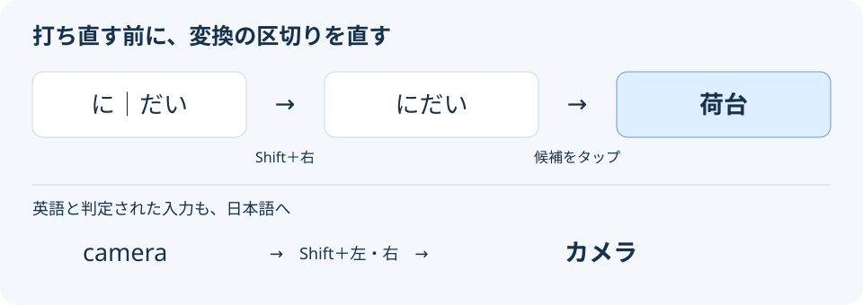

# Meltype Android 1.2.1 利用ガイド

ローマ字で日本語と英語を入力するためのガイドです。対応端末・APKの入手先・画面は[README](../README.txt)を参照してください。本家Meltype 1.3.0を基にした非公式Android版で、1.2.0は端末内zenzモデルを搭載し、現在の実機設定を初期値として配布します。端末内AIは既定ONです。

## 1. 使い始める

1. APKをインストールしてMeltypeアプリを開きます。
2. 「有効にする」で有効にし、「キーボードを選ぶ」でMeltypeを選びます。
3. 試し書き欄でkyouhagoogledekensakuと入力します。日英を混ぜた入力と変換候補を確認できます。

別のキーボードにはAndroidの入力方法切替から戻せます。有効にする際の警告は、キーボードが入力内容を扱うことについてAndroidが表示するものです。

## 2. 入力・変換・確定

通常は日英自動判別です。日本語はMozcでライブ変換し、英語と判断した部分は英字として扱います。変換の候補はキーボードの上に表示します。候補欄は横へスクロールできます。通常の変換候補を先に並べ、語句・英単語の予測はその後ろへ表示します。英語の予測で変換候補を先頭から押し出しません。Androidでは2文字以上のかなから最有力の変換結果を本文へ表示します（例：natu → 夏）。

本版は、設定「zenzで文脈変換・誤字補正する」がONなら高速化した端末内zenzモデルを使います。OFFなら境界付近のタッチと既存の誤字規則による補正を使います。英語・型番・機密欄の保護や、通常候補を手動で選ぶ操作は維持します。

- 空白で変換・候補選択、確定キーで確定します。未確定文字がない場合、確定キーは入力先の改行・送信・次へ等として働きます。
- 候補をタップすると選択文節まで確定し、後ろの文節は編集を続けられます。
- 入力先で未確定の前の文節へカーソルを移すと、その文節の候補を変更できます。確定後は次の文節の候補を左端から表示します。
- 左右矢印は、ライブ変換中も含め、現在の文節から隣の文節へ1つずつ移動します。端では止まります。未確定文字がない場合は入力先のカーソルを移動します。
- Shiftを2回押して固定し、左右矢印で選択文節を縮小・拡大します。未操作のライブ変換では右端の文節が対象です。後続の文節がない場合、Shift＋右矢印では範囲を変更しません。Shiftをもう一度押して解除すると通常の移動へ戻ります。

「ごじ／goji」からは「五時」「誤字」「護持」などを選べます。エンジンの文節分割と、全体の読みの同音語候補を両立させています。

英語と判定された入力を日本語に直す場合も、日英自動モードのままShiftを固定し、左右矢印で文節を変更できます。たとえば `camera` はShift＋左、Shift＋右で読みの文節を縮めて戻し、「カメラ」を候補から選べます。英語専用モードでは直接入力を維持します。

## 3. 日英・文字種のメニュー

日英・カナ・自動キーのタップで、英語専用入力や、未確定文字のカタカナ・自動判別を切り替えます。切替時の動作は未確定文字と現在のモードにより異なり、キー表示もカナ・自動・英語等へ変わります。

同じキーを上へフリックすると、次の5種類を選べます。長押しでは開きません。

| 操作 | 用途 |
| --- | --- |
| ひらがな | 未確定文字をひらがなにする |
| カタカナ | 全角カタカナにする |
| 半角カタカナ | 半角カタカナにする |
| 全角英数字 | 全角の英字・数字にする |
| 半角英数字 | 半角の英字・数字にする |

文字種の変更を選択文節だけに適用する設定があります。取消のメニューと設定は1.1.0で削除しました。

## 4. キー・記号・空白

Shiftは次の1文字、2回押すと固定です。文字キーを上へフリックするか長押しすると、右上に表示した数字・記号を入力します。削除は長押しで連続入力できます。複数の指の操作は押した順序を保ちます。

123・ABCで英字配列と記号配列を切り替えます。このキーの長押しでは、乗算記号、等号、丸括弧・角括弧・波括弧、バックスラッシュ、不等号、^、|、~を選べます。

()と「」は括弧の組として入力します。空白・候補で種類を選び、確定するとローマ字配列へ戻ります。括弧内へカーソルを移す設定もあります。

初期状態の空白は半角、Shiftと空白は全角です。「通常の空白を全角にする」がONなら、通常は全角でShift時は半角です。「Shiftと空白で半角スペースを入れる」がONなら、通常が半角の場合もShiftで半角になります。

設定画面で読点は、・，・,、句点は。・．・.から選び、「句読点を保存」を押します。日本語の初期値は，と．です。英語入力は半角です。句読点キーは限定した語尾を手掛かりに文末を推定して表示を変えます。文の意味を理解して判断する機能ではありません。

## 5. 数字・電話番号と片手表示

入力先が数字・電話番号の欄を指定すると専用配列を表示します。整数、負数、小数、符号付き小数、数値パスワード、電話番号に応じてキーを変えます。電話番号の0は長押しで+を入力します。変換・学習は行いません。通常の文字欄へ戻るとQWERTY配列へ戻ります。

1.2.1では物理キーボード接続中でも、パスワード・PIN欄で画面キーボードを表示します。通常の文字・URL・日付欄はAndroidの物理キーボード設定に従います。

候補がない場合の「片手」で、右寄せ・左寄せ・全幅の順に切り替えます。左右寄せは幅80％で、配列の高さを維持します。選んだ表示は次回も使います。

## 6. クリップボード

コピー後に初めてキーボードを開いたとき、未確定文字や変換候補がなければコピー内容を候補欄へ表示します。1タップで貼り付けられます。閉じた後、入力・確定・貼り付け後には同じコピーを再表示しません。同じ文を再コピーすれば新しいコピーとして扱います。

▤で履歴を開き、項目をタップして貼り付けます。×で元の配列へ戻り、「全消去」で履歴を消せます。履歴は最大10件・1時間、メモリー内だけに保持し、1万文字を超える項目や空白だけの項目は保持しません。Androidが保持する過去の全履歴を復元する機能ではありません。

数字・小数・電話番号欄でも初回候補と履歴を使えます。入力可能な文字は入力先アプリの制限に従います。数値パスワードを含むパスワード欄では表示・貼り付けを無効にします。画像・URI形式・機密指定のクリップは取り込みません。

「読みからクリップボードを変換する」は別の任意設定です。「ぺーすと」「くりっぷぼーど」を変換したときだけコピー内容を候補へ加えます。学習禁止などの制限付き入力欄では使いません。

## 7. 追加設定の全共通20項目と端末内AIの1項目

Meltypeアプリの「入力設定」で設定します。設定した後は入力欄を開き直してください。保存済みの設定は更新時に上書きしません。初期値は[初期設定一覧](ANDROID_DEFAULT_SETTINGS_1_2_0.md)を参照してください。

### 変換候補

| 設定 | 初期値 | 動作 |
| --- | --- | --- |
| 計算結果を候補に出す | ON | 式を入力して空白で変換します。例：1+2*3 → 7。乗算記号は123キーの長押しから入力できます。 |
| 子音の略入力を候補に出す | OFF | 子音中心の略入力を候補に加えます。例：ast → 明日。 |
| 読みからクリップボードを変換する | OFF | ぺーすと・くりっぷぼーど等の読みを変換し、コピー内容を候補に加えます。 |
| 語句・英単語の予測候補を表示する | ON | 保存された語句や英単語の予測を表示し、タップで確定します。変換の学習がONで、学習を許可した欄で使えます。 |
| 予測候補に英字の社名・サービス名を含める | ON | 語句・英単語の予測と併用し、読みから英字の社名・サービス名を出します。例：shaomi → Xiaomi。 |
| 入力中の変換候補を表示する | ON | 空白を押す前から変換候補を表示します。OFFの場合は明示的な変換操作を使います。 |

### 記号・空白

| 設定 | 初期値 | 動作 |
| --- | --- | --- |
| 丸括弧を全角にする | ON | 丸括弧の初期候補を（）にします。候補から他の種類も選べます。 |
| 括弧の確定後に内側へ移動する | ON | 括弧を確定した後、括弧の内側へカーソルを移します。 |
| 角括弧を［ ］にする | OFF | 角括弧を［ ］として入力します。 |
| スラッシュを全角にする | OFF | スラッシュの全角入力を有効にします。 |
| かなの後のwを笑いとして残す | ON | かなの直後のwを、笑いを表すwとして残します。 |
| 通常の空白を全角にする | OFF | 通常の空白を全角にします。Shiftと空白では半角を入力します。 |
| Shiftと空白で半角スペースを入れる | OFF | 通常の空白が半角の場合も、Shiftと空白で半角を入力します。OFFならShiftと空白は全角です。 |

### 入力操作

| 設定 | 初期値 | 動作 |
| --- | --- | --- |
| 表示どおりに確定する | OFF | 表示中の文字を確定時に別の判定へ変えず、その表示どおりに確定します。 |
| 文字種の変更は選択文節だけに適用する | OFF | 文字種を変える操作を、選んだ文節だけに適用します。 |
| 英数字の文字種変更は打ったままから始める | OFF | 英数字への文字種変更を、最初は入力どおりの大小文字から始めます。 |
| 英字を中心に入力する | OFF | 英字を中心に入力します。文字種メニューからひらがな等へ変更できます。 |

### 学習・表示

| 設定 | 初期値 | 動作 |
| --- | --- | --- |
| 英語・日本語の学習を前の文脈で分ける | OFF | 前の文脈が英語か日本語かで、変換の学習を分けます。 |
| 入力したローマ字を候補欄に表示する | OFF | 入力したローマ字を候補欄へ表示します。 |

予測候補はタップで確定します。保存した語句は長押しで学習から削除できます。

## 8. ユーザー辞書

1. 「単語登録・辞書の取り込み」を開き、読みと単語・定型文を入力して登録します。
2. 次に入力欄を開き、読みを入力して候補から登録語を選びます。
3. 他の辞書は「ファイルを取り込む」から、SimejiのJSONまたはUTF-8／UTF-16のタブ区切りファイルを選びます。

1文字・英字の読みと改行を含む定型文に対応します。既存の登録を残して重複を除きます。ファイルは1MB、登録は5000件までです。単語を含む文章を無条件に部分置換する機能ではありません。詳しくは[辞書の仕様](ANDROID_USER_DICTIONARY.md)を参照してください。

## 9. 学習とデータ

「変換の学習」をOFFにすると、新しい変換の学習や個人向け予測を停止し、既存の辞書・学習データは保持します。入力先が学習禁止を指定した欄でも個人向け処理を停止します。パスワード・数字・電話番号・日時の欄では変換と学習を行いません。

編集履歴を収集してPCへ取得する画面はありません。個人の誤字学習では、利用者が訂正して確定した短いローマ字の組と回数だけを端末内へ保存します。

入力と変換は端末内で処理し、入力内容を送信しません。通信は利用者がアプリ内更新を操作した場合だけ行います。通常の変換学習では確定した語句や言語判定を端末内に保存する場合があります。辞書・学習データを消すにはAndroidのアプリ情報からデータを消去します。アンインストールでも消えます。キーボードを切り替えるだけでは消えません。保存対象と除外条件は[SECURITY.md](../SECURITY.md)を参照してください。

## 10. 困ったとき

- 設定が効かない場合は入力欄を閉じて開き直してください。英字名の予測には語句・英単語の予測もONにし、変換の学習を許可した欄で確認してください。
- コピー候補が出ない場合は、新しくテキストをコピーしてからキーボードを開いてください。同じコピーの再表示はしません。履歴には▤からアクセスできます。
- パスワード等の検出は入力先アプリの指定に依存します。変換・改行・送信・カーソル移動の挙動が異なる場合は、アプリ名と再現操作を添えて報告してください。個人の入力文や辞書をIssueへ貼らないでください。

かな配列のフリック入力・音声入力、Androidの再変換UI、クラウド同期、Gboardの履歴との連携、GitHubタイトル取得には対応していません。実機での長時間入力・アプリごとの挙動・押しやすさを、エミュレーターの結果だけで保証するものではありません。

## 11. 端末内AI（zenz）

1.2.0では端末内AIの判定結果を再利用し、補正後の表記が決まった場合は重複する推論を省きます。新規インストール時はONです。設定からOFFにして、既存の誤字規則とタッチによる補正だけを使うこともできます。

「端末内AI／zenzで文脈変換・誤字補正する」は新規導入時にONです。ONにすると、文節の区切りで同梱zenzが文脈を使ってかな漢字変換します。誤字案がある場合は、先に元の表示と修正案を比較し、採用した読みを変換します。同音語変換では通常候補を保持し、誤字の訂正を採用した場合は訂正後の読みから通常の変換候補を作り直します。zenzの処理に通信は不要です。初回の準備や推論は端末性能・入力により時間がかかり、誤選択もあります。失敗・期限切れは元の表示を使います。

「表示どおりに確定する」がONの場合、Enterは推論を待たず表示中の内容を確定します。推論待ちを含む確定を試す場合はこの設定をOFFにします。推論を終えるまで待たずに入力を続けた場合も、表示を維持することがあります。

zenzの補正は入力欄の未確定文字にだけ反映し、候補操作には通常の変換エンジンの文節と候補を使います。候補を手動で選んだ箇所は、その選択を優先します。型番向けの専用2択候補も追加しません。周辺文や推論ログは保存しません。個人誤字学習の短い訂正組は別ファイルへ保存します。通常の変換学習の保存は別の設定です。

個人の誤字学習（ローカル修正）：zenzと変換の学習がONの場合、未確定の短いローマ字を訂正して確定すると、zenzが訂正を確認します。手動訂正を1回承認すると、次回から文脈を確認して自動補正します。訂正からキーの押し間違い・脱字・重複・順序逆転を学び、別の語にも応用します。端末内に短い訂正前後と回数だけを保存します。モデルの重みは変更せず、周辺文は保存・送信しません。詳細はdocs/ANDROID_PERSONAL_TYPO_LEARNING.md。

コピー直後の候補は、入力ビューの再開始で消さず、最初の表示を維持します。表示できない入力欄ではコピーを消費済みにせず、通常の入力欄を開いたときに表示します。入力・貼り付け・入力先の変更後は同じコピーを再提示しません。

## アプリ内更新

「アプリを更新」で最新版を確認し、更新があれば「更新」を押します。APKを自動でダウンロードしてAndroidの更新確認へ進みます。初回だけMeltypeからのインストールを許可してください。学習用版に対応した配布物がない場合は、通常版を別アプリとして案内せず更新なしと表示します。

高速化は完全一致要求の結果再利用と、表記まで選択済みの訂正結果を後段生成へ引き継ぐ処理です。誤字訂正が入力途中で一時的に戻る場合、実タッチから期待した訂正先を選べない場合、64打鍵/100文字の上限は既知の制限です。

PhoneDeskなどから届く通常のキー入力は、画面キーボードと同じ変換処理で扱います。追加のモードや設定は不要です。通常の文字・Space・Enter・Backspace・矢印を利用できます。パスワード・数字欄やCtrl等のショートカットはAndroid標準の処理に渡します。画面の文字種メニュー・Shift・矢印・候補選択は引き続き使えます。
